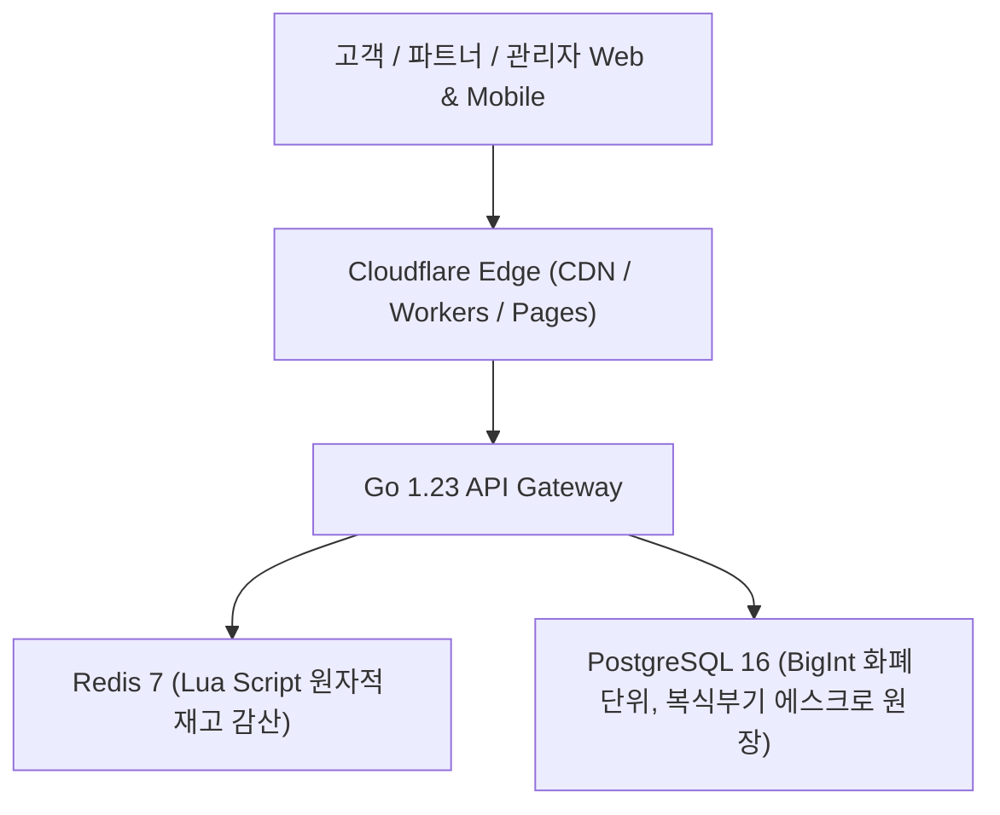

# ⚡ OpenMarket — 차세대 글로벌 오픈마켓 플랫폼

> **Temu 벤치마킹 기반 고성능 글로벌 e커머스 시스템**  
> Go 1.23+, PostgreSQL 16, Redis 7 Lua 동시성 제어, OpenAPI 3.0 SSOT, Cloudflare Edge 배포

---

## 1. 시스템 아키텍처 개요

OpenMarket은 대규모 트래픽과 초특가 타임세일(Flash Sale) 환경에서 데이터 무결성과 초고속 응답 속도를 보장하기 위해 설계된 엔터프라이즈 마켓플레이스입니다.



---

## 2. 3대 핵심 콘솔 (3 Consoles)

1. **Customer Storefront (고객 쇼핑몰)**
   - 번개특가(Flash Sale) 실시간 카운트다운 및 33대 글로벌 카테고리 네비게이션
   - 장바구니 통합 결제 및 판매자별 주문 자동 분기(Split-Order)
2. **Partner Console (파트너 입점사 센터)**
   - 입점 신청 및 승인 상태 관리
   - 상품/SKU 등록, 재고 관리, 배송 운송장 입력(State Machine 기반 배송 처리)
   - 수수료 10% 자동 차감 정산(Net Payout) 리포트
3. **Admin Console (통합 총괄 어드민)**
   - 입점 파트너사 심사 및 승인
   - Server-Driven UI (SDUI) 홈 피드 동적 레이아웃 배포
   - 복식부기(Double-entry) 기반 에스크로 원장 대사 및 정산 집행

---

## 3. 핵심 기술 명세

### A. 무결점 원자적 재고 감산 (Redis 7 Lua Engine)
- **위치**: `backend/internal/infra/redis/scripts/deduct_stock.lua` & `stock_deductor.go`
- **특징**:
  - 멱등키(`idempotency_key`) 검증을 통한 중복 결제 원천 차단
  - 1인당 구매 수량 제한(`per_user_limit`) Lua 내 원자적 검증
  - 다중 상품 주문 중 일부 실패 시 자동 보상 트랜잭션(Compensation Rollback) 지원

### B. PostgreSQL 16 코어 데이터 모델
- **위치**: `backend/migrations/000001_core_enterprise_schema.up.sql` & `000002_category_taxonomy_seed.up.sql`
- **특징**:
  - 부동소수점 오차 방지를 위해 모든 통화 필드 `BIGINT` 엄격 적용
  - 복식부기 원장 테이블: `ledger_accounts`, `ledger_transactions`, `ledger_entries`
  - 상태 전이 무결성을 위한 Sub-Order 상태 머신 연동
  - 33대 글로벌 버티컬 카테고리 택소노미 시드 포함

### C. 주문 분기 (Split-Order Architecture)
- **위치**: `backend/internal/service/checkout_service.go`
- **특징**:
  - 단일 장바구니 결제 건에 대해 판매자(Partner)별 `sub_orders` 및 `order_items` 분기 생성
  - 판매자별 무료 배송 기준금액(Free Shipping Threshold) 독립 계산

---

## 4. 백엔드 테스트 및 검증 결과

Go 1.23+ 환경에서 모든 핵심 도메인 로직 및 상태 머신 테스트 통과:

```bash
$ go test -v ./...
=== RUN   TestOrderStateMachine_AllTransitions
--- PASS: TestOrderStateMachine_AllTransitions (0.00s)
=== RUN   TestCheckoutService_SplitOrderAndShipping
--- PASS: TestCheckoutService_SplitOrderAndShipping (0.00s)
=== RUN   TestOrderStateMachine_Transitions
--- PASS: TestOrderStateMachine_Transitions (0.00s)
PASS
ok      openmarket/backend/internal/domain/statemachine 0.980s
ok      openmarket/backend/internal/service             0.800s
```

---

## 5. Cloudflare Edge 배포 구성

`wrangler.toml` 및 `public/index.html` 기반의 Cloudflare Workers / Pages 정적 에셋 서빙:

```toml
name = "openmarket"
compatibility_date = "2024-04-03"

[assets]
directory = "./public"
```

---

## 6. 디렉토리 구조

```
openmarket/
├── backend/
│   ├── go.mod / go.sum
│   ├── internal/
│   │   ├── domain/statemachine/   # Sub-Order 상태 머신
│   │   ├── infra/redis/           # Redis Lua 재고 감산 & 롤백
│   │   └── service/               # Split-Order 체크아웃 서비스
│   └── migrations/                # PG16 DDL 및 33대 카테고리 시드
├── docs/
│   └── openapi/                   # OpenAPI 3.0 SSOT 규격
├── public/
│   └── index.html                 # 3-Console 통합 인터랙티브 프론트엔드
├── wrangler.toml                  # Cloudflare Edge 배포 설정
└── Makefile                       # 빌드 및 배포 자동화
```
