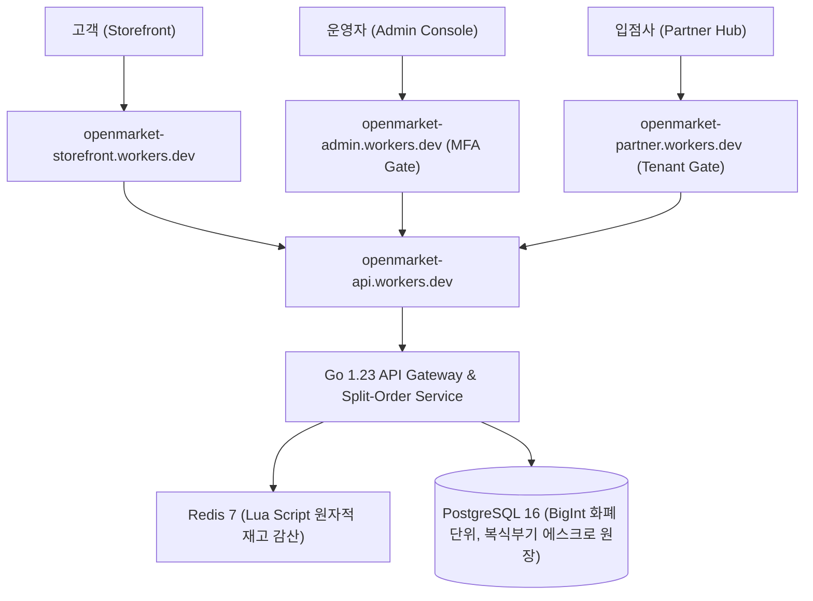

# ⚡ OpenMarket — 차세대 글로벌 오픈마켓 플랫폼

> **Temu 벤치마킹 기반 고성능 글로벌 e커머스 시스템**  
> Go 1.23+, PostgreSQL 16, Redis 7 Lua 동시성 제어, OpenAPI 3.0 SSOT, Cloudflare 4대 서비스 독립 배포

---

## 1. Cloudflare 실배포 4대 독립 서비스 현황

OpenMarket은 단일 페이지 데모가 아닌, 4개의 완전한 독립 Cloudflare Workers 서비스로 구축되어 실시간 운영 중입니다.

| 서비스 구분 | Cloudflare Worker 명칭 | 실 배포 운영 URL | 역할 및 보안 정책 |
|---|---|---|---|
| **고객 쇼핑몰 (메인)** | `openmarket` | [https://openmarket.dnjstjqppk.workers.dev](https://openmarket.dnjstjqppk.workers.dev) | 글로벌 초특가 쇼핑몰, 33대 카테고리, 장바구니/결제 |
| **고객 쇼핑몰 (전용)** | `openmarket-storefront` | [https://openmarket-storefront.dnjstjqppk.workers.dev](https://openmarket-storefront.dnjstjqppk.workers.dev) | 전용 스토어프론트 엔드포인트 |
| **통합 관리자 콘솔** | `openmarket-admin` | [https://openmarket-admin.dnjstjqppk.workers.dev](https://openmarket-admin.dnjstjqppk.workers.dev) | **MFA 보안 인증 게이트 적용**, 파트너 심사, 복식부기 원장 |
| **파트너 판매자 센터** | `openmarket-partner` | [https://openmarket-partner.dnjstjqppk.workers.dev](https://openmarket-partner.dnjstjqppk.workers.dev) | **입점사 로그인 및 테넌트 격리**, 상품/SKU 관리, 운송장 출고 |
| **통합 백엔드 API** | `openmarket-api` | [https://openmarket-api.dnjstjqppk.workers.dev](https://openmarket-api.dnjstjqppk.workers.dev) | Edge API Gateway (`/health`, `/api/v1/categories`, `/api/v1/orders/checkout`) |

---

## 2. 시스템 아키텍처 개요

대규모 트래픽과 초특가 번개세일(Flash Sale) 환경에서 데이터 무결성과 초고속 응답 속도를 보장하기 위해 설계된 엔터프라이즈 마켓플레이스입니다.



---

## 3. 핵심 기술 명세 및 무결성 보장

### A. 무결점 원자적 재고 감산 (Redis 7 Lua Engine)
- **위치**: `backend/internal/infra/redis/scripts/deduct_stock.lua` & `stock_deductor.go`
- **특징**:
  - 멱등키(`idempotency_key`) 검증을 통한 중복 결제 원천 차단
  - 1인당 구매 수량 제한(`per_user_limit`) Lua 내 원자적 검증
  - 다중 상품 주문 중 일부 실패 시 자동 보상 트랜잭션(Compensation Rollback) 지원

### B. PostgreSQL 16 코어 데이터 모델
- **위치**: `migrations/` (000001 ~ 000006)
- **특징**:
  - 부동소수점 오차 방지를 위해 모든 통화 필드 `BIGINT` 엄격 적용
  - 복식부기 원장 테이블: `ledger_accounts`, `ledger_transactions`, `ledger_entries`
  - 상태 전이 무결성을 위한 Sub-Order 상태 머신 연동
  - 33대 글로벌 버티컬 카테고리 택소노미 시드 포함

### C. 주문 분기 (Split-Order Architecture)
- **위치**: `backend/internal/service/checkout_service.go`
- **특징**:
  - 단일 장바구니 결제 건에 대해 판매자(Partner)별 `sub_orders` 및 `order_items` 분기 생성
  - 판매자별 무료 배송 기준금액(Free Shipping Threshold) 독립 계산

---

## 4. 백엔드 테스트 및 검증 결과

Go 1.23+ 환경에서 모든 핵심 도메인 로직 및 상태 머신 테스트 통과:

```bash
$ npm test
> cd backend && go test -v ./...
=== RUN   TestOrderStateMachine_AllTransitions
--- PASS: TestOrderStateMachine_AllTransitions (0.00s)
=== RUN   TestCheckoutService_SplitOrderAndShipping
--- PASS: TestCheckoutService_SplitOrderAndShipping (0.00s)
=== RUN   TestOrderStateMachine_Transitions
--- PASS: TestOrderStateMachine_Transitions (0.00s)
PASS
ok      openmarket/backend/internal/domain/statemachine 0.980s
ok      openmarket/backend/internal/service             0.800s
```

---

## 5. 디렉토리 구조

```
openmarket/
├── apps/
│   ├── storefront/                # 고객 쇼핑몰 (openmarket-storefront)
│   ├── admin/                     # 관리자 콘솔 (openmarket-admin)
│   ├── partner/                   # 파트너 콘솔 (openmarket-partner)
│   └── api/                       # 통합 Edge API (openmarket-api)
├── backend/
│   ├── go.mod / go.sum
│   ├── internal/domain/           # 도메인 모델 및 상태머신
│   ├── internal/infra/redis/      # Redis Lua 재고 감산
│   └── internal/service/          # Split-Order 및 체크아웃
├── migrations/                    # PostgreSQL 16 DDL 6종
├── docs/                          # 시스템 아키텍처 및 QA 문서 22종
├── public/                        # 루트 진입점 (Customer Storefront)
└── package.json                   # 모노레포 워크스페이스
```

## 1. Cloudflare 실배포 4대 독립 서비스 현황

OpenMarket은 단일 페이지 데모가 아닌, 4개의 완전한 독립 Cloudflare Workers 서비스로 구축되어 실시간 운영 중입니다.

| 서비스 구분 | Cloudflare Worker 명칭 | 실 배포 운영 URL | 역할 및 보안 정책 |
|---|---|---|---|
| **고객 쇼핑몰 (메인)** | `openmarket` | [https://openmarket.dnjstjqppk.workers.dev](https://openmarket.dnjstjqppk.workers.dev) | 글로벌 초특가 쇼핑몰, 33대 카테고리, 장바구니/결제 |
| **고객 쇼핑몰 (전용)** | `openmarket-storefront` | [https://openmarket-storefront.dnjstjqppk.workers.dev](https://openmarket-storefront.dnjstjqppk.workers.dev) | 전용 스토어프론트 엔드포인트 |
| **통합 관리자 콘솔** | `openmarket-admin` | [https://openmarket-admin.dnjstjqppk.workers.dev](https://openmarket-admin.dnjstjqppk.workers.dev) | **MFA 보안 인증 게이트 적용**, 파트너 심사, 복식부기 원장 |
| **파트너 판매자 센터** | `openmarket-partner` | [https://openmarket-partner.dnjstjqppk.workers.dev](https://openmarket-partner.dnjstjqppk.workers.dev) | **입점사 로그인 및 테넌트 격리**, 상품/SKU 관리, 운송장 출고 |
| **통합 백엔드 API** | `openmarket-api` | [https://openmarket-api.dnjstjqppk.workers.dev](https://openmarket-api.dnjstjqppk.workers.dev) | Edge API Gateway (`/health`, `/api/v1/categories`, `/api/v1/orders/checkout`) |

---

## 2. 시스템 아키텍처 개요

대규모 트래픽과 초특가 번개세일(Flash Sale) 환경에서 데이터 무결성과 초고속 응답 속도를 보장하기 위해 설계된 엔터프라이즈 마켓플레이스입니다.


---

## 3. 핵심 기술 명세 및 무결성 보장

### A. 무결점 원자적 재고 감산 (Redis 7 Lua Engine)
- **위치**: `backend/internal/infra/redis/scripts/deduct_stock.lua` & `stock_deductor.go`
- **특징**:
  - 멱등키(`idempotency_key`) 검증을 통한 중복 결제 원천 차단
  - 1인당 구매 수량 제한(`per_user_limit`) Lua 내 원자적 검증
  - 다중 상품 주문 중 일부 실패 시 자동 보상 트랜잭션(Compensation Rollback) 지원

### B. PostgreSQL 16 코어 데이터 모델
- **위치**: `migrations/` (000001 ~ 000006)
- **특징**:
  - 부동소수점 오차 방지를 위해 모든 통화 필드 `BIGINT` 엄격 적용
  - 복식부기 원장 테이블: `ledger_accounts`, `ledger_transactions`, `ledger_entries`
  - 상태 전이 무결성을 위한 Sub-Order 상태 머신 연동
  - 33대 글로벌 버티컬 카테고리 택소노미 시드 포함

### C. 주문 분기 (Split-Order Architecture)
- **위치**: `backend/internal/service/checkout_service.go`
- **특징**:
  - 단일 장바구니 결제 건에 대해 판매자(Partner)별 `sub_orders` 및 `order_items` 분기 생성
  - 판매자별 무료 배송 기준금액(Free Shipping Threshold) 독립 계산

---

## 4. 백엔드 테스트 및 검증 결과

Go 1.23+ 환경에서 모든 핵심 도메인 로직 및 상태 머신 테스트 통과:

```bash
$ npm test
> cd backend && go test -v ./...
=== RUN   TestOrderStateMachine_AllTransitions
--- PASS: TestOrderStateMachine_AllTransitions (0.00s)
=== RUN   TestCheckoutService_SplitOrderAndShipping
--- PASS: TestCheckoutService_SplitOrderAndShipping (0.00s)
=== RUN   TestOrderStateMachine_Transitions
--- PASS: TestOrderStateMachine_Transitions (0.00s)
PASS
ok      openmarket/backend/internal/domain/statemachine 0.980s
ok      openmarket/backend/internal/service             0.800s
```

---

## 5. 디렉토리 구조

```
openmarket/
├── apps/
│   ├── storefront/                # 고객 쇼핑몰 (openmarket-storefront)
│   ├── admin/                     # 관리자 콘솔 (openmarket-admin)
│   ├── partner/                   # 파트너 콘솔 (openmarket-partner)
│   └── api/                       # 통합 Edge API (openmarket-api)
├── backend/
│   ├── go.mod / go.sum
│   ├── internal/domain/           # 도메인 모델 및 상태머신
│   ├── internal/infra/redis/      # Redis Lua 재고 감산
│   └── internal/service/          # Split-Order 및 체크아웃
├── migrations/                    # PostgreSQL 16 DDL 6종
├── docs/                          # 시스템 아키텍처 및 QA 문서 22종
├── public/                        # 루트 진입점 (Customer Storefront)
└── package.json                   # 모노레포 워크스페이스
```

