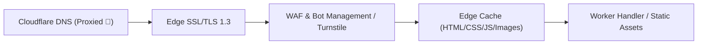

# Cloudflare 인프라 아키텍처 명세서 (CLOUDFLARE_ARCHITECTURE)

## 1. 인프라 개요
OpenMarket은 전 세계 300개 이상의 엣지 데이터센터를 보유한 Cloudflare의 서버리스 인프라 위에 배포됩니다.
각 프론트엔드 콘솔과 API는 독립 프로젝트로 분리되어 장애 격리 및 무중단 배포를 달성합니다.

| 서비스 구분 | Cloudflare 프로젝트명 | 인프라 유형 | 주요 바인딩 및 기능 |
|---|---|---|---|
| 고객 쇼핑몰 | `openmarket-storefront` | Workers Static Assets | 정적 자산 캐싱, 브라우저 라우팅 |
| 관리자 콘솔 | `openmarket-admin` | Workers Static Assets | WAF 접근 제어, 감사 로그 |
| 파트너 콘솔 | `openmarket-partner` | Workers Static Assets | R2 대용량 미디어 업로드 연동 |
| 백엔드 API | `openmarket-api` | Cloudflare Workers | Hyperdrive (PG16), KV 캐시 |

## 2. 엣지 라우팅 및 보안 체계

## 3. 스토리지 및 캐싱 구성
1. **Cloudflare R2**:
   - 상품 이미지, 동영상, 입점사 사업자등록증 등 비정형 대용량 파일 저장
   - S3 호환 API를 통해 Presigned URL 발급 및 직접 업로드 지원
2. **Cloudflare Hyperdrive**:
   - PostgreSQL 16과의 커넥션 풀링(Connection Pooling) 및 엣지 쿼리 가속
   - 트랜잭션 오버헤드 최소화 및 콜드 스타트 지연 제거
3. **Cloudflare Rate Limiting**:
   - `/api/v1/orders/checkout`: IP당 초당 10회 제한
   - `/api/v1/auth/login`: IP당 분당 5회 제한 및 Turnstile 캡차 적용

