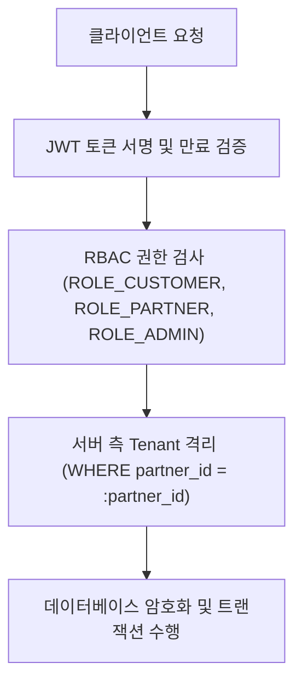

# 보안 아키텍처 및 권한 격리 명세서 (SECURITY_ARCHITECTURE)

## 1. 다중 계층 보안 모델 (Multi-Layer Security Model)
OpenMarket은 제로 트러스트(Zero Trust) 원칙을 준수하여 프론트엔드의 화면 제어뿐만 아니라 모든 백엔드 API 및 DB 쿼리 레벨에서 엄격한 권한 격리를 강제합니다.

## 2. 역할 및 테넌트(Tenant) 격리 정책
1. **파트너사 간 완벽한 데이터 격리 (Strict Multi-Tenancy)**:
   - 모든 파트너 관련 API는 JWT 클레임에 포함된 `partner_id`를 기반으로 서버 측 SQL 조건절에 `partner_id = $1`을 강제 주입합니다.
   - 프론트엔드 URL 파라미터 조작을 통한 타 파트너의 상품, 주문, 정산서 접근 시 즉시 `403 Forbidden` 반환 및 보안 감사 로그 기록.
2. **관리자 권한 분리 및 감사 추적 (Admin Governance)**:
   - `ROLE_SUPER_ADMIN`, `ROLE_OPERATOR`, `ROLE_FINANCE` 등으로 세분화.
   - 파트너 승인, 정산 배치 실행 등 민감 작업은 `audit_logs` 테이블에 실행자 ID, 대상 리소스, IP, 요청 본문 메타데이터 영구 보존.

## 3. 금융 거래 무결성 및 암호화
- **비밀번호**: Argon2id 기반 단방향 솔트 해싱 적용
- **카드 정보 비보존 원칙**: 신용카드 번호는 자체 DB에 일절 저장하지 않으며, PG사 발급 일회용 결제 빌링키/토큰만 취급
- **중복 결제 방어**: 클라이언트가 전송한 UUID `X-Idempotency-Key`를 Redis 및 DB Unique Constraint로 동시 검증

