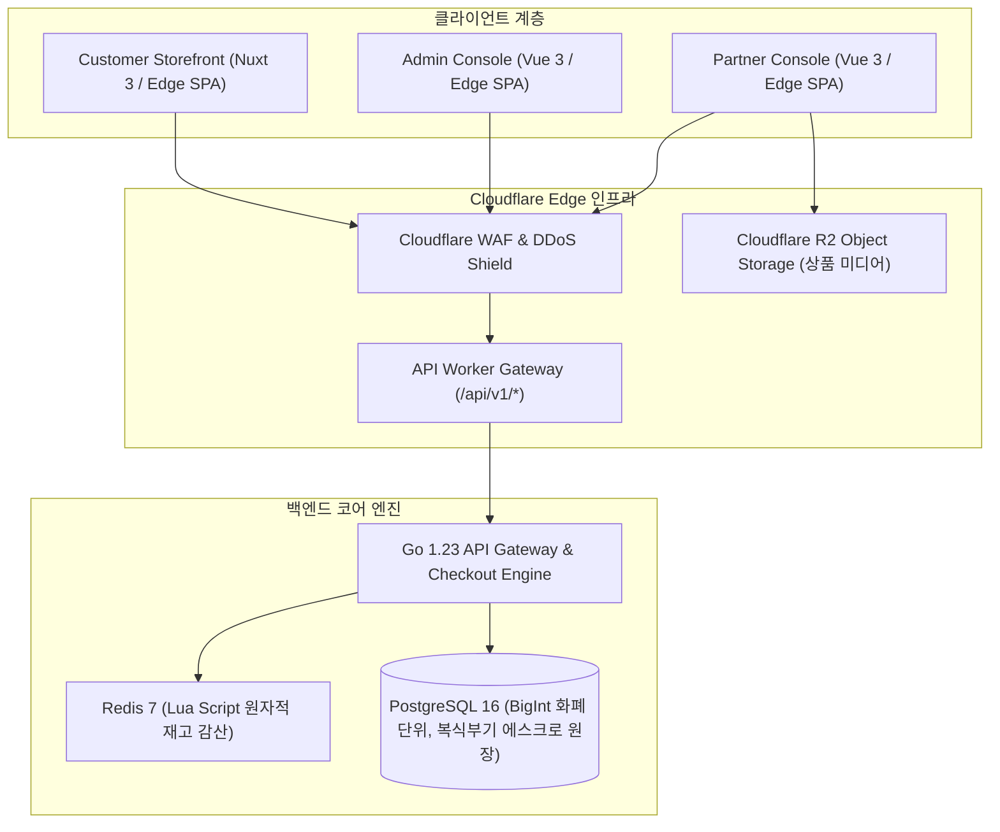

# OpenMarket — 전체 시스템 아키텍처 명세서 (SYSTEM_ARCHITECTURE)

## 1. 개요 및 벤치마킹 설계
OpenMarket은 초당 10,000건 이상의 동시 주문 및 타임특가(Flash Sale) 트래픽을 처리하는 글로벌 종합 마켓플레이스입니다.
Temu의 고효율 이커머스 운영 구조를 벤치마킹하여 무재고·오픈마켓 중개 모델과 자체 풀필먼트 연계를 동시에 수용할 수 있는 분산 엣지 아키텍처로 구현되었습니다.

## 2. 4대 독립 배포 단위 (Cloudflare Projects)
1. **Customer Storefront (`openmarket-storefront`)**: 고객 상품 탐색, 번개특가, 다국어/다중통화, Split-Order 장바구니 및 체크아웃
2. **Admin Console (`openmarket-admin`)**: 플랫폼 총괄, 파트너 입점 심사, 복식부기 에스크로 원장 감사, SDUI 레이아웃 엔진
3. **Partner Console (`openmarket-partner`)**: 판매자 포털, 상품/SKU 등록, CSV 대량 업로드, 운송장 입력 및 출고 상태머신, 월별 정산서
4. **Backend API Gateway (`openmarket-api`)**: 통합 엣지 라우팅, 인증/권한 토큰 검증, 주문 분기 처리, 헬스체크

## 3. 핵심 아키텍처 불변 규칙
- **금액 처리**: 모든 화폐 필드는 부동소수점 오차 방지를 위해 `BIGINT` 엄격 적용 (KRW 원단위, USD 센트 단위)
- **원자적 재고 감산**: Redis 7 Lua 스크립트를 통해 초과 판매(Overselling)를 0%로 통제하고 멱등키 보장
- **복식부기 회계 원장**: 결제 발생 시 `PG_RECEIVABLE` 차변, `PLATFORM_ESCROW` 대변 동시 기장
