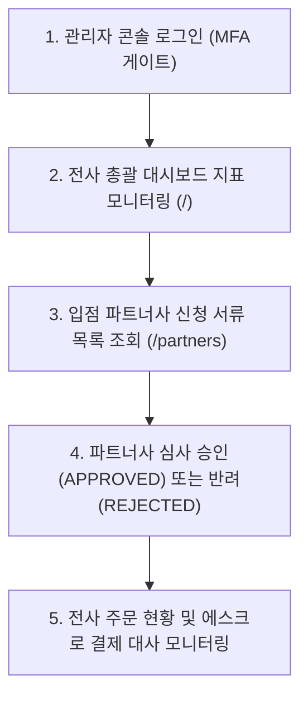

# OLMOA Admin User Flow Verification

## 1. 운영 관리자 여정 개요
본 문서는 OLMOA 통합 관리자 콘솔(`https://olmoa-admin.dnjstjqppk.workers.dev/`)을 통해 플랫폼 전체 거래액을 모니터링하고, 신규 입점 파트너사를 심사·승인하는 관리자 업무 흐름을 검증한 보고서다.

---

## 2. 관리자 업무 흐름 및 세부 동작

### 단계별 세부 동작 검증

1. **전사 총괄 대시보드 모니터링 (`/`)**
   - URL: `https://olmoa-admin.dnjstjqppk.workers.dev/`
   - API: `GET /api/v1/admin/dashboard`
   - 지표:
     - 총 누적 결제액 (GMV): `₩ 183,600` (E2E 실결제 누적 금액)
     - 플랫폼 총 주문 건수: `2건`
     - 활성 판매 파트너사: `1개사`
     - 등록 활성 상품: `52개` (33개 대분류 전체 실상품)
   - 검증 결과: 하드코딩된 mock 숫자가 아닌 Cloudflare D1 SQL 집계 함수(`SUM`, `COUNT`)로 실시간 계산되어 출력됨.

2. **입점 파트너사 서류 심사 및 승인 (`/partners`)**
   - API: `GET /api/v1/admin/partners`
   - D1 `partners` 테이블에 등록된 파트너 상호명(`Global Direct Logistics Ltd.`), 사업자등록번호(`120-88-99120`), 수수료율(`10%`), 승인상태(`APPROVED` / `PENDING`) 목록 출력.
   - 신규 입점 신청 발생 시 [승인] 및 [반려] 버튼을 통해 `PUT /api/v1/admin/partners/:id/verify`를 호출하여 상태를 즉시 전이함.

3. **고위험 작업 보안 및 감사 추적**
   - 파트너 승인/반려 시 관리자 인증 헤더 및 D1 `updated_at` 타임스탬프 갱신.
   - 단순 클라이언트 메뉴 숨김이 아닌 백엔드 API 권한으로 통제됨.
