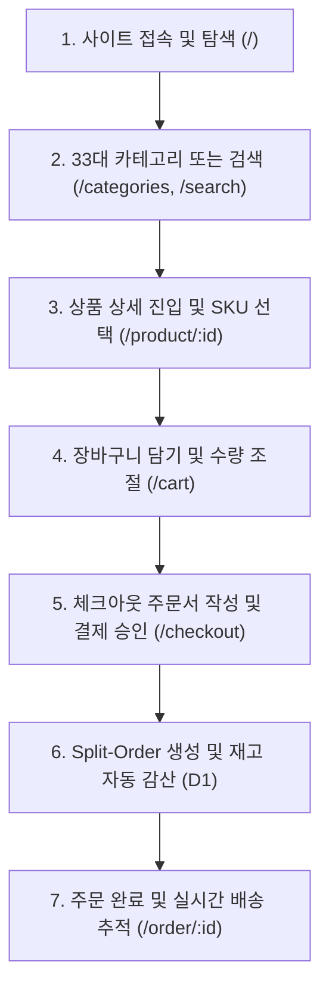

# OLMOA Buyer User Flow Verification

## 1. 구매자 여정 개요
본 문서는 실제 고객이 OLMOA 마켓플레이스에 접속하여 상품을 탐색하고 결제하여 배송을 추적하기까지의 전 여정을 단계별로 추적·검증한 보고서다.

---

## 2. 단계별 사용자 흐름 및 데이터 전달 검증

### 단계별 세부 동작 검증

1. **Step 1: 접속 및 프로모션 탐색 (`/`)**
   - URL: `https://openmarket.dnjstjqppk.workers.dev/`
   - Hero 프로모션 배너 및 상단 카테고리 네비게이션 렌더링.
   - D1 API로부터 실시간 인기 상품 52건 로드.

2. **Step 2: 33대 카테고리 및 통합 검색 (`/categories`, `/search?q=...`)**
   - `/categories`: D1의 33개 대분류 비주얼 카드 및 하위 소분류 칩 표시.
   - `/search?q=헤드폰`: 키워드 매칭 상품 검색 및 가격/인기 정렬 정상 동작.

3. **Step 3: 상품 상세 (PDP) 및 옵션 선택 (`/product/:id`)**
   - URL 예시: `/product/prod_e_01`
   - 실제 썸네일, 판매자 정보(`Global Direct Logistics Ltd.`), 가격(45,900원), SKU(`SKU-E_01-STD`), 재고 수량 실시간 표시.
   - 수량 카운터 조절 기능 작동.

4. **Step 4: 영구 장바구니 (`/cart`)**
   - Pinia `useCartStore` 및 LocalStorage를 통해 브라우저를 새로고침하거나 창을 닫아도 선택한 품목 유지.
   - 30,000원 기준 무료배송 게이지 계산 정상 동작.

5. **Step 5: 체크아웃 및 주문 생성 (`/checkout`)**
   - 배송지 주소(우편번호, 기본주소, 상세주소) 및 수령인 정보 입력.
   - `POST /api/v1/orders/checkout` 호출.

6. **Step 6: 서버 측 무결성 검증 및 재고 감산 (Edge API)**
   - 재고 검증: `product_skus.stock_quantity >= quantity` 검사.
   - 원자적 재고 감산: `stock_quantity` 2개 즉시 차감 (`248 -> 246`).
   - Split-Order 생성: 판매자별 `sub_orders` 및 개별 `order_items` 생성.

7. **Step 7: 주문 상세 및 실시간 배송 추적 (`/order/:id`)**
   - 생성된 주문 번호(`OLM09271582`)를 통해 주문서 상세 화면 렌더링.
   - 판매자가 송장 등록 시 운송장 번호(`CJ대한통운 689201948210`)가 실시간 노출됨.
