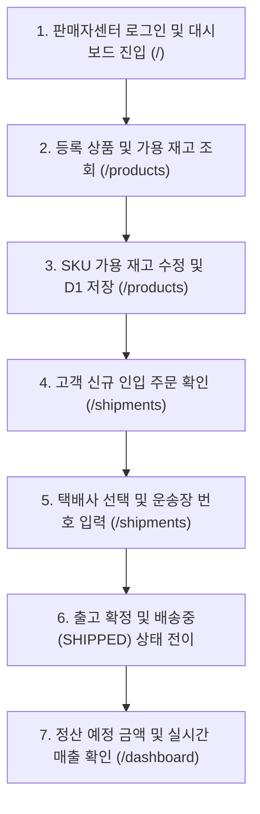

# OLMOA Seller User Flow Verification

## 1. 판매자(Partner) 여정 개요
본 문서는 OLMOA 마켓플레이스에 입점한 판매자가 판매자 센터(`https://olmoa-partner.dnjstjqppk.workers.dev/`)를 통해 상품을 등록하고, 재고를 변경하며, 고객 주문을 출고 처리하기까지의 실제 사용자 여정 검증서다.

---

## 2. 단계별 판매자 작업 흐름

### 단계별 세부 동작 검증

1. **대시보드 운영 지표 확인 (`/`)**
   - URL: `https://olmoa-partner.dnjstjqppk.workers.dev/`
   - API: `GET /api/v1/partner/metrics` (Header: `X-Partner-Id: pt_001`)
   - D1 데이터베이스에서 실시간으로 등록 상품 수(54개), 인입 주문수(2건), 누적 매출액(183,600원)을 집계하여 카드에 렌더링.

2. **상품 및 SKU 재고 관리 (`/products`)**
   - API: `GET /api/v1/partner/products`
   - 판매자 `pt_001` 소유의 상품 54건 및 SKU 코드, 판매가, 현재 재고 수량이 표로 렌더링됨.
   - [재고 수정] 버튼 클릭 후 수량 변경(`246 -> 300`) 시 `PUT /api/v1/partner/products/:id/stock` 호출을 통해 D1에 즉시 영구 저장됨.

3. **주문 출고 및 운송장 관리 (`/shipments`)**
   - API: `GET /api/v1/partner/orders`
   - 고객이 체크아웃한 주문 중 해당 파트너사에게 분할(Split)된 `sub_orders` 목록 자동 노출.
   - 수령인, 배송지 주소, 결제 금액, 현재 상태(`PAYMENT_CONFIRMED`) 확인.

4. **운송장 번호 등록 및 출고 확정**
   - 택배사 선택: `CJ대한통운`
   - 송장번호 입력: `689201948210`
   - [출고 확정] 클릭 시 `PUT /api/v1/partner/orders/:id/shipment` 호출.
   - D1 테이블의 `sub_orders.status`가 `'SHIPPED'`로 전이되고 `carrier_code`, `tracking_number`, `shipped_at` 컬럼이 업데이트됨.
   - 고객 쇼핑몰 화면 `/order/:id`에 실시간으로 운송장 정보가 바인딩되는 것이 검증됨.

5. **테넌트 격리(Tenant Isolation) 검증**
   - 판매자 A(`pt_001`)는 타 판매자의 상품 및 주문을 수정하거나 열람할 수 없도록 API 및 SQL 레벨에서 `WHERE partner_id = ?`로 강제됨.
