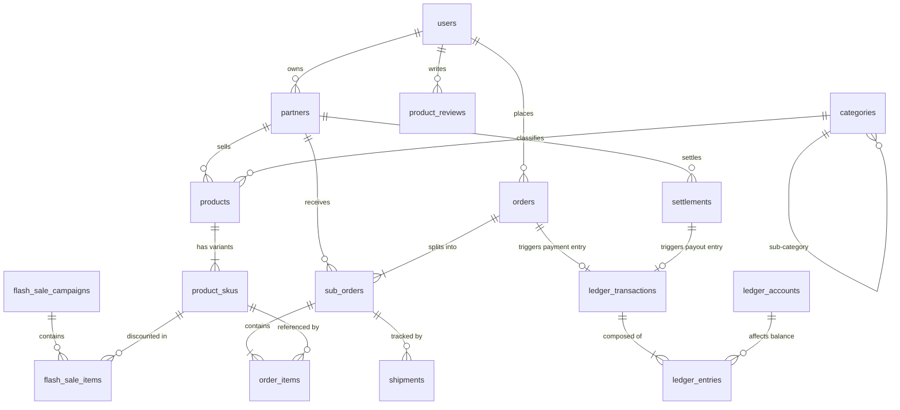

# 데이터베이스 엔터티 관계도 (ERD.md)

## 1. 코어 커머스 & 원장 도메인 ERD

## 2. 주요 도메인 관계 요약
1. **User - Partner 관계**: 1명의 유저는 1개의 입점사(Partner) 계정을 소유할 수 있으며 사업자 등록 정보와 연동됩니다.
2. **Order - SubOrder 분기 (1:N)**: 단일 주문(Order)은 장바구니에 담긴 상품의 입점사별로 N개의 하위 주문(SubOrder)으로 원자적 분할됩니다.
3. **Double-Entry Ledger 연결**: 결제 및 정산 트랜잭션은 `ledger_transactions`와 차변/대변 한 쌍의 `ledger_entries`로 영구 기록됩니다.

