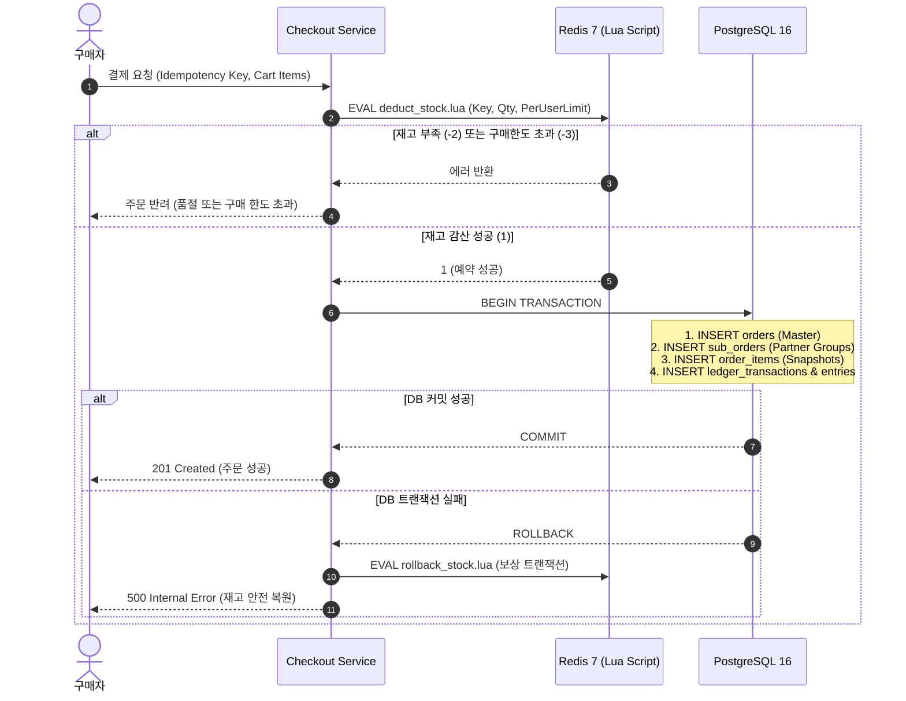

# 트랜잭션 및 동시성 제어 설계서 (TRANSACTION_DESIGN.md)

## 1. 2단계 커밋 및 재고 예약 동시성 제어 (Two-Phase Stock Reservation)
초당 10,000건의 타임특가 동시 주문 요청 시 DB Lock Contention을 방지하기 위해 Redis In-Memory 원자적 감산과 RDBMS 후속 트랜잭션을 분리합니다.

## 2. 복식부기 에스크로 회계 분개 규칙
모든 주문 결제 완료 시 다음과 같은 대차평형 분개가 즉시 실행됩니다:
- **차변 (DEBIT)**: `101. PG_RECEIVABLE` (PG사로부터 정산받을 총 결제금액)
- **대변 (CREDIT)**: `201. PLATFORM_ESCROW` (구매확정 전 플랫폼이 임시 보관하는 고객 예치금)

구매 확정 시:
- **차변 (DEBIT)**: `201. PLATFORM_ESCROW`
- **대변 (CREDIT)**: `202. PARTNER_PAYABLE` (파트너 정산 부채, 90%)
- **대변 (CREDIT)**: `401. PLATFORM_REVENUE` (플랫폼 수수료 매출, 10%)
