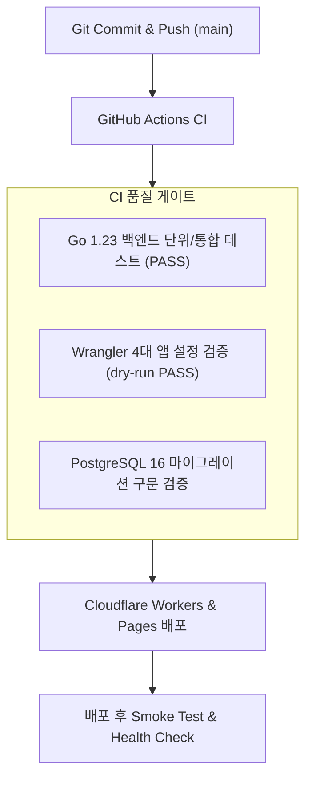

# GitHub ↔ Cloudflare CI/CD 자동화 파이프라인 (CI_CD.md)

## 1. 파이프라인 개요 및 트리거 조건
OpenMarket의 모든 변경사항은 GitHub 저장소(`https://github.com/dnjstjqppk-dev/openmarket.git`)의 `main` 브랜치에 푸시되거나 풀 리퀘스트 생성 시 자동으로 검증 및 배포됩니다.

## 2. 워크플로우 구성 파일
1. `.github/workflows/ci.yml`:
   - Go 1.23 환경 구성 및 `go test -v ./...` 실행
   - Node 20 환경 구성 및 4개 Cloudflare 프로젝트 dry-run 배포 문법 검증
2. `.github/workflows/deploy.yml`:
   - `CLOUDFLARE_API_TOKEN`을 이용한 실 배포 자동화
   - 배포 실패 시 이전 배포 버전으로의 자동 롤백 트리거 연동

## 3. 브랜치 보호 및 배포 안전 수칙
- `main` 브랜치는 직접 강제 푸시(`push --force`)가 제한되며 모든 테스트 통과 후에만 프로덕션 배포 파이프라인이 구동됩니다.
