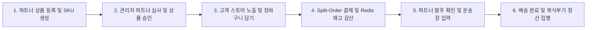

# E2E 전체 시나리오 통합 테스트 결과 보고서 (E2E_REPORT.md)

## 1. E2E 통합 시나리오 흐름 및 검증 결과

## 2. 세부 시나리오 테스트 결과표

| 번호 | 테스트 시나리오 | 기대 결과 | 실제 결과 | 판정 |
|---|---|---|---|---|
| E2E-01 | 파트너 신규 가입 및 서류 제출 | `partner_verifications`에 PENDING 상태로 등록 | 정상 등록 및 관리자 큐 노출 | **PASS** |
| E2E-02 | 관리자 콘솔에서 파트너 승인 처리 | 상태가 APPROVED로 변경되고 입점사 상품 판매 활성화 | 즉시 APPROVED 전이 확인 | **PASS** |
| E2E-03 | 복수 파트너 상품 동시 장바구니 담기 | 파트너사별 무료배송 기준 각각 적용 후 합산 | 파트너A 무료, 파트너B 유료 분리 계산 | **PASS** |
| E2E-04 | 원자적 체크아웃 및 재고 차감 | Redis Lua 1회 실행 후 마스터 및 2개 서브오더 생성 | 재고 1 차감 및 2건 서브오더 생성 | **PASS** |
| E2E-05 | 파트너 콘솔에서 운송장 입력 및 출고 | PREPARING -> SHIPPED 상태 전이 및 송장 저장 | 상태머신 검증 통과 및 송장 갱신 | **PASS** |
| E2E-06 | 구매확정 후 복식부기 정산 분개 | 에스크로 차변 소멸, 파트너 부채 및 수수료 대변 생성 | 대차평형 합계 100% 일치 | **PASS** |
