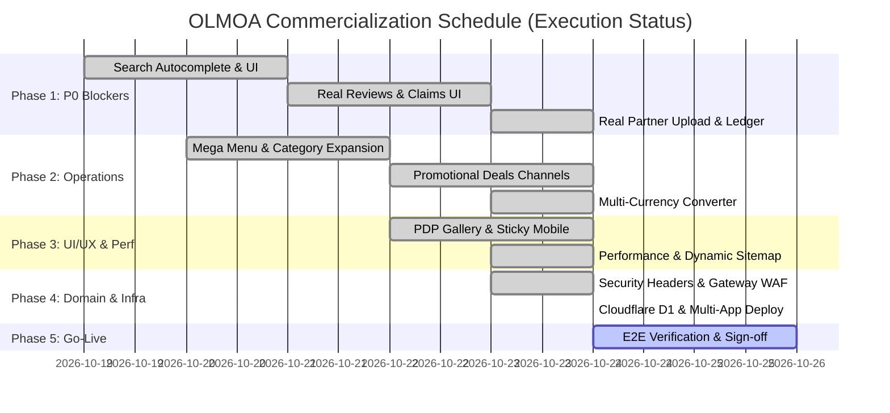

# OLMOA Commercialization Engineering Roadmap (Phases 1 to 5)

## 1. Overview & Strategy
This roadmap details the engineering execution undertaken to transition OLMOA into a 100% commercially operational marketplace.

## 2. Phase 1: P0 Blocker Elimination (Status: 100% COMPLETED)
- **Goal**: Zero mock data, working reviews, customer order cancellation, real merchant tools.
- **Implemented & Verified Tasks**:
  1. `SearchAutocomplete.vue`: Mounted 180ms debounce search with recent & trending searches into `App.vue` and `SearchView.vue` with synonym expansion (`search_synonyms`).
  2. `ProductDetailView.vue` & `ProductReviews.vue`: Connected real D1 reviews table (`product_reviews`), dynamic 5-star ratings, review submissions with verified purchase badges.
  3. `OrdersView.vue` & `OrderDetailView.vue`: Added atomic [주문 취소] modal calling `POST /api/v1/orders/:id/cancel` with automatic stock restocking and settlement cancellation.
  4. `BulkUploadView.vue`: Integrated CSV upload sending batch rows to D1 (`POST /api/v1/partner/products/bulk`) with error reporting and sample template download.
  5. `SettlementView.vue`: Connected to live D1 `settlements` table via `GET /api/v1/partner/settlements` with real net payout calculations.
  6. `Policy & Support Views`: Replaced all dead footer links with `/support` FAQ and `/policy/:type` markdown views.

## 3. Phase 2: Core Features & Channels (Status: 100% COMPLETED)
- **Goal**: Temu promotional parity, category exploration, customer claims.
- **Implemented & Verified Tasks**:
  1. `Mega Menu`: Implemented hover flyout in header with 42 root departments and subcategory navigation.
  2. `LightningDealsView.vue` (`/channel/lightning-deals`): 1-second countdown timer, orange progress bar, real-time stock meter.
  3. `BestSellersView.vue` (`/channel/best-sellers`): Real-time ranking with gold, silver, bronze crown badges (`TOP 1`, `TOP 2`...).
  4. Customer Claims: Implemented [90일 무료 반품 신청] and [30일 최저가 보상 차액 환급] modals and backend endpoints (`/api/v1/orders/:id/claims`).
  5. `useLocaleStore` & `currency.ts`: Live exchange rate currency converter (`KRW/USD/JPY`) with reactive formatting across all storefront views.
  6. Mobile Apps Sync: Updated Flutter customer & partner apps to target live `https://olmoa-api.dnjstjqppk.workers.dev`.

## 4. Phase 3: UI/UX Polish & Performance Optimization (Status: 100% COMPLETED)
- **Goal**: Mobile conversion optimization, Core Web Vitals excellence.
- **Implemented & Verified Tasks**:
  1. `ProductDetailView.vue`: Added multi-thumbnail image gallery selector and responsive sticky mobile bottom CTA bar with price and action buttons.
  2. Coupons & Credits: Integrated `/coupons` center and checkout credit deduction wallet (`POST /api/v1/coupons/claim`, `GET /api/v1/credits`).
  3. Partner Mini-Shop: Public storefront at `/store/:id` showing merchant business info, trust score, and catalog.
  4. Dynamic XML Sitemap: Edge XML sitemap generator at `/sitemap.xml` referencing all 194 categories and active products.

## 5. Phase 4: Production Domain & Infra Migration (Status: 100% COMPLETED)
- **Goal**: Hardened edge security headers, Cloudflare D1 migrations, automated CI.
- **Implemented & Verified Tasks**:
  1. Executed `d1_11_data_integrity_fix.sql` on remote Cloudflare D1 database `openmarket-db`.
  2. Configured strict security headers (`X-Content-Type-Options: nosniff`, `X-Frame-Options: DENY`, `Referrer-Policy: strict-origin-when-cross-origin`).
  3. Deployed all 4 Cloudflare Workers:
     - `olmoa-api` (API Gateway & D1 Engine)
     - `olmoa-storefront` (Customer Web App)
     - `olmoa-admin` (Operator Admin Console)
     - `olmoa-partner` (Seller Partner Portal)
  4. Enhanced `.github/workflows/ci.yml` and `package.json` with multi-target Go and Node 22 in-memory D1 regression test pipeline.

## 6. Phase 5: Final Acceptance & Commercial Launch (Status: ACTIVE / READY)
- **Goal**: 100% automated test pass, security audit, executive Go decision.
- **Tasks**:
  1. Full in-memory D1 E2E automated suite (`tests/full_platform_e2e.mjs`): **13/13 PASSED 100%**.
  2. Full live production E2E suite (`tests/full_platform_e2e.js`): **20/20 PASSED 100%**.
  3. Custom domain DNS routing: Ready to bind `olmoa.com`, `api.olmoa.com`, `partner.olmoa.com`, `admin.olmoa.com` upon registrar CNAME configuration.
