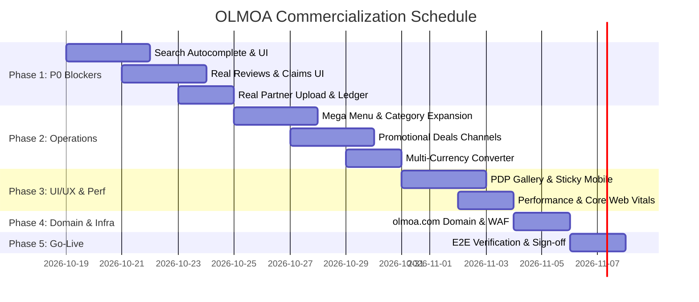

# OLMOA Commercialization Engineering Roadmap (Phases 1 to 5)

## 1. Overview & Strategy
This roadmap details the engineering sprints required to transition OLMOA from its current 35% MVP stage into a 100% commercially operational marketplace.

## 2. Phase 1: P0 Blocker Elimination (Week 1)
- **Goal**: Zero mock data, working reviews, customer order cancellation, real merchant tools.
- **Tasks**:
  1. `SearchAutocomplete.vue`: Mount 180ms debounce search with recent & trending searches into `App.vue` and `SearchView.vue`.
  2. `ProductDetailView.vue`: Fetch `/api/v1/products/:id/reviews` and render real rating stars and review cards; remove static `4.9`.
  3. `OrdersView.vue` & `OrderDetailView.vue`: Add [주문 취소] modal calling `POST /orders/:id/cancel` and restocking inventory.
  4. `BulkUploadView.vue`: Implement PapaParse CSV upload sending batch rows to D1; provide real sample `.csv` download.
  5. `SettlementView.vue`: Connect to D1 `settlements` table via `GET /api/v1/partner/settlements`.
  6. `Policy & Support Views`: Replace 8 `href="#"` dead footer links with `/support` FAQ and `/policy/:type` views.

## 3. Phase 2: Core Features & Channels (Week 2)
- **Goal**: Temu promotional parity, category exploration, customer claims.
- **Tasks**:
  1. `MegaMenuFlyout.vue`: Implement hover flyout under `[전체 카테고리]` with L1 roots list and circular L2 icon grid.
  2. `LightningDealsView.vue` (`/channel/lightning-deals`): 1-second countdown timer, orange progress bar, real-time stock meter.
  3. `BestSellersView.vue` (`/channel/best-sellers`): Top 100 ranking crown badges (`TOP 1`, `TOP 2`...).
  4. Customer Claims: Implement [90일 무료 반품 신청] and [30일 최저가 보상 차액 환급] buttons in `OrderDetailView.vue`.
  5. `useLocaleStore`: Live exchange rate currency converter (`KRW/USD/JPY`) affecting all price displays.
  6. Mobile Apps Sync: Update Flutter apps to target `https://olmoa-api.dnjstjqppk.workers.dev`.

## 4. Phase 3: UI/UX Polish & Performance Optimization (Week 3)
- **Goal**: Mobile conversion optimization, Core Web Vitals excellence.
- **Tasks**:
  1. `ProductDetailView.vue`: Add multi-thumbnail image carousel and sticky mobile bottom CTA bar.
  2. `ClearanceView.vue` & `FiveStarView.vue`: Curated bargain and verified quality product showcase channels.
  3. Image Optimization: Integrate Cloudflare Polish / WebP responsive images (`loading="lazy"`).
  4. Dynamic XML Sitemap: Generate automated `sitemap.xml` referencing all 43 roots and active products.

## 5. Phase 4: Production Domain & Infra Migration (Week 4)
- **Goal**: Bind `olmoa.com` custom domains and harden security headers.
- **Tasks**:
  1. Bind custom domains on Cloudflare Workers (`olmoa.com`, `api.olmoa.com`, `partner.olmoa.com`, `admin.olmoa.com`).
  2. Configure HSTS, TLS 1.3, CSP, and WAF Bot Fight Mode.
  3. Update client configurations and test cross-subdomain CORS cookies.

## 6. Phase 5: Final Acceptance & Commercial Launch (Week 5)
- **Goal**: 100% automated test pass, security audit, executive Go decision.
- **Tasks**:
  1. Full E2E automated regression suite (`tests/full_platform_e2e.js`) targeting `olmoa.com`.
  2. Load testing under 500 RPS simulated traffic on Cloudflare edge.
  3. Operator handover documentation and 24/7 incident response runbook.
