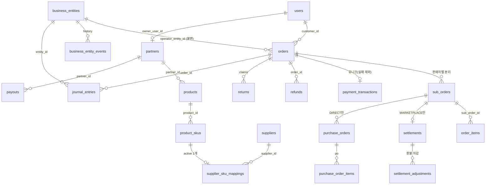

# B. DB 감사 보고서

## 1. 현재(감사 시점) 스키마의 주요 문제

| # | 문제 | 영향 |
|---|---|---|
| 1 | `orders.payment_status` 기본값이 `'PAID'` | 결제 없이 결제완료 주문 생성 |
| 2 | `sub_orders.status` CHECK에 코드가 쓰는 `PURCHASE_CONFIRMED` 없음, `settlements.status` CHECK에 `ELIGIBLE_FOR_PAYOUT` 없음 | 자동 구매확정이 **CHECK 위반으로 항상 실패**하는 코드 경로 |
| 3 | 재고·적립금·쿠폰에 DB 레벨 불변식 없음 | 동시성에서 초과판매·이중사용 |
| 4 | 금액 배분 컬럼 없음 (쿠폰·적립금이 주문 합계에만 존재) | 부분환불 금액을 정확히 계산할 근거 없음 |
| 5 | 결제 1건 유니크 제약 없음, 환불 테이블 없음 | 이중 결제·환불 추적 불가 |
| 6 | 원장(`inventory_ledger`, `user_credits`) 수정·삭제 가능 | 감사 추적 훼손 가능 |
| 7 | 운영 사업자 개념 없음 | 법인 전환 시 거래 귀속 구분 불가 |
| 8 | `commission_rate REAL`(10.0 = 10%)과 코드의 `0.1` 혼용 | 수수료 단위 혼동 |
| 9 | `user_coupons`에 (user, coupon) 유니크 없음 | 중복 발급 |

금액 컬럼은 모두 `INTEGER`(원 단위)로 부동소수점 문제는 없었습니다. 이 원칙을 유지했고, 수수료는 정수 bps(`commission_rate_bps`)로 계산합니다.

## 2. 개선 후 스키마 — `migrations/d1_20_integrity_foundation.sql`

### 2-1. ERD (핵심)

### 2-2. 테이블 변경

| 구분 | 테이블 | 내용 |
|---|---|---|
| 신규 | `business_entities`, `business_entity_events` | 운영 사업자(개인/법인), 활성 운영자 1개 부분 유니크 인덱스, 변경 이력(불변) |
| 재구성 | `orders` | 상태 집합 확장(READY/EXPIRED/REFUNDED…), 기본값 `READY`, 쿠폰·적립금·환불 금액 분리, `operator_entity_id`, 고객별 멱등키 유니크 |
| 재구성 | `sub_orders` | `sales_model`(DIRECT/MARKETPLACE), 배송비의 적립금/PG 배분, 상태 집합 확장 |
| 재구성 | `settlements` | `commission_rate_bps`, 상태 `HOLD→PENDING→ELIGIBLE_FOR_PAYOUT→PAID_OUT`, 사업자 귀속 |
| 재구성 | `returns` | `sub_order_id`, `items_json`, 처리자·처리시각, 주문당 가격보상 1회 유니크 |
| 추가 컬럼 | `order_items` | `coupon_alloc`/`credit_alloc`/`pg_alloc`, 환불 수량·금액 누계, 직영 원가 |
| 신규 | `refunds`, `payment_events`, `idempotency_keys`, `settlement_adjustments`, `payouts`, `journal_entries`, `admin_audit_log`, `suppliers`, `supplier_sku_mappings`, `purchase_orders`, `purchase_order_items`, `batch_assertions` | 아래 3절 |

### 2-3. 정확한 금액 배분 규칙

- 쿠폰 할인 → 품목 금액 비율로, 적립금 → (품목 순액 + 판매자별 배송비) 비율로 **최대잔여법** 배분: 합계가 항상 1원 단위로 일치.
- 품목마다 `line_total = coupon_alloc + credit_alloc + pg_alloc` (대사 R03).
- 부분환불: 수량 비례 `floor`, 마지막 환불은 남은 금액 전부 → 여러 번 나눠 환불해도 합계 = 결제액 (테스트 I16, 무작위 2,000건 속성 테스트 I30).

## 3. 제약조건·트리거 (DB가 마지막 방어선)

| 트리거 | 막는 것 |
|---|---|
| `trg_sku_stock_nonnegative` | 재고 음수 → 주문 배치 전체 롤백 (초과판매 방지) |
| `trg_credit_balance_nonnegative` | 적립금 잔액 음수 (동시 이중사용) |
| `trg_user_coupon_single_use` | 사용된 쿠폰 재사용 |
| `trg_orders_payment_transition` | 허용되지 않은 결제 상태 전이 (예: 취소→결제완료, 결제완료→결제완료) |
| `trg_order_items_refund_caps` | 결제액·수량 초과 환불 |
| `trg_sub_orders_shipping_refund_once` | 배송비 이중 환불 |
| `trg_*_no_update/no_delete` | 재고원장·분개·감사로그·결제이벤트·적립금·사업자 이력 수정/삭제 |
| `trg_orders_entity_frozen`, `trg_settlements_entity_frozen` | 거래의 운영 사업자 귀속 변경 (법인 전환 시 일괄 덮어쓰기 금지) |
| `trg_batch_assertion_abort` | 배치 중간 검증 실패 시 롤백 (예: 지급 금액 드리프트) |
| `refunds` CHECK | `goods + shipping = coupon_reversal + pg + credit` |
| `journal_entries` CHECK | 한 행에 차변·대변 중 하나만, 음수 금지 |

인덱스: 고객별 주문, 결제대기 만료 스캔, 판매자별 하위주문 상태, 배송완료 자동확정 스캔, 분개 거래/계정/사업자, 감사로그 대상.

## 4. 트랜잭션·동시성 검증

D1의 `batch()`는 단일 트랜잭션입니다. 모든 상태 변경은 한 배치로 커밋하고, 배치 사이(조회→쓰기) 경쟁은 트리거·유니크 제약이 배치를 롤백시켜 처리합니다. 테스트 하네스는 조회와 쓰기 사이에 경쟁 쓰기를 주입해 이를 재현합니다(I05, I21, I26). 환불은 PG 호출(외부)을 사이에 두므로 **예약(1차 배치) → PG 취소 → 확정(2차 배치)** 2단계이며, PG 실패 시 예약을 되돌립니다(I19). 10분 넘게 `PENDING`인 환불은 대사 R07이 표시합니다.

## 5. 데이터 대사 (`GET /api/v1/admin/reconciliation`, 22개 검사 — V3.1에서 R18~R21 추가)

R01 분개 차대 일치 · R02 주문 산식 · R03 품목 배분 · R04/R04b 하위주문 합계 · R05 결제 1건=결제액 · R06 환불 누계 · R07 정체 환불 · R08 PG 정산계정 · R09 적립금 원장=부채−결제대기 예약분 · R10 판매자 미지급금 · R11 정산 산식 · R12 판매모델별 정산/발주 · R13 직영 발주서 · R14 재고원장=주문수량 · R15 음수재고 · R16/R17 사업자 귀속 · **R18 지급 산식(이체액 = 정산액 − 리저브 보류 + 리저브 해제, 보류 행과 일치)** · **R19 지급 1건 = 운영 사업자 1곳** · **R20 환불 1건: PG + 적립금 + 차감 반품배송비 = 환불 품목·배송비 몫** · **R21 주문 환불 누계 + 차감액 = 품목·배송비 환불 몫 합계**.

V3.1부터 대사는 Cron에서 1시간마다 자동 실행되어 `reconciliation_runs`에 기록되고(수동 실행도 기록), 실패 시 `ALERT_WEBHOOK_URL`로 알림합니다.
모든 테스트 시나리오(취소·부분취소·반품·정산 후 환불·법인 전환 포함) 실행 후 전부 통과합니다 (I31, 기능 E2E 26, 브라우저 B11).

## 6. 마이그레이션 · 복구 계획 (운영 적용은 승인 후)

1. **백업**: `wrangler d1 export openmarket-db --remote --output=backup_pre_d1_20.sql` 및 D1 Time Travel 북마크 기록 (`wrangler d1 time-travel info openmarket-db`).
2. **리허설**: 백업 파일을 로컬 D1에 복원 → `d1_20` 적용 → `PRAGMA foreign_key_check`, 대사 API 실행. (현재 저장소 시드 기준으로는 로컬 workerd D1에서 적용 성공 확인: `evidence/06`)
3. **적용**: `wrangler d1 execute openmarket-db --remote --file migrations/d1_20_integrity_foundation.sql` (트래픽 적은 시간, 배포와 동시에).
4. **검증**: `/health`, 대사 API, 주문 0건 상태에서 테스트 결제(토스 테스트 키).
5. **롤백**: `wrangler d1 time-travel restore openmarket-db --bookmark=<1단계 북마크>` 후 이전 Worker 버전 재배포. `d1_20`은 테이블을 재구성하므로 SQL 역마이그레이션 대신 Time Travel 복원을 표준 롤백으로 합니다.
6. 기존 주문 행은 `legacy_record = 1`, 사업자 미귀속으로 보존되며 대사에서 제외됩니다 (실거래가 아니었던 데이터).

## 7. V3.1 추가 마이그레이션 (모두 추가 전용, `d1_20` 이후 순서대로)

| 파일 | 내용 | 롤백 |
|---|---|---|
| `d1_21_reserve_and_ops.sql` | `partners.rolling_reserve_days`, `payouts.gross_amount/reserve_held/reserve_released`, `payout_reserve_holds`(1회 해제·삭제 불가 트리거), `payouts` 금액 동결·삭제 금지 트리거, `reconciliation_runs` | 새 객체 미사용 또는 Time Travel |
| `d1_23_seller_onboarding.sql` | 입점 신청·심사 컬럼, `partner_kyb_documents`(삭제 금지, 파일 교체 금지), `storage_objects.visibility` | 새 객체 미사용 또는 Time Travel |
| `d1_24_admin_security.sql` | `users.admin_role`(기존 운영자 → SUPER_ADMIN), TOTP 비밀키(암호화)·마지막 사용 시간단계·복구코드 해시, 운영자 외 역할 부여 금지 트리거 | 새 컬럼 미사용 또는 Time Travel |
| `d1_25_claims_policy.sql` | `partners.return_shipping_fee`, `returns` 사유·귀책·차감액·교환 컬럼, `refunds.return_fee_amount`(변경 금지) | 새 컬럼 미사용 또는 Time Travel |
| `d1_22_privacy_lifecycle.sql` | `users.withdrawn_at`, `orders.pii_purged_at`, `support_inquiries.pii_purged_at`, `pii_access_log`(수정·삭제 불가), 탈퇴 계정 복구 금지 트리거 | 새 객체 미사용 또는 Time Travel |

적용 절차는 6절과 같습니다(백업 → 리허설 → 적용 → 대사). 운영 D1 적용은 **승인 후** 진행하며 이번 작업에서 운영 DB는 건드리지 않았습니다.
