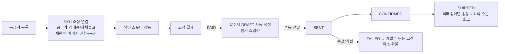
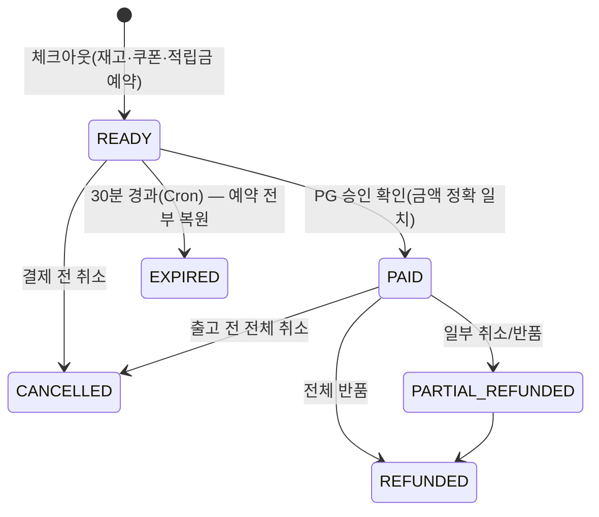

# C. 비즈니스 플로우 분석서

## 1. MODEL A — 운영자 직영 B2B 소싱 판매

구현 상태
- 공급사·소싱·발주서·상태 전이·마진 표시: **구현** (`routes/suppliers.js`, 관리자 `공급사·발주` 화면).
- **재판매 권한 미확인 SKU는 결제 단계에서 판매 차단** (I24).
- 직영 매출은 `DIRECT_SALES_REVENUE`로 운영 사업자에 귀속, 판매자 정산 없음 (R12).
- 공급사 API 자동 발주: **미구현** (계약 없음 — 상태값 `api_integration_status=NONE`, 화면에 '미연동' 표기).
- 매입 원가 회계(매입채무·매출원가 분개): **미구현** — 발주서 원가는 기록되나 분개는 없음 (다음 단계).

## 2. MODEL B — 입점 판매자

정산 산식(정수): `gross = 판매가 합계(수량할인 반영)`, `commission = round_half_up(gross × bps / 10000)`, `net = gross − commission + 배송비`. 쿠폰·적립금은 **플랫폼 부담**이라 판매자 정산액을 줄이지 않습니다(판매자 부담 쿠폰은 미구현).

## 3. 혼합 장바구니

하나의 결제(PG 1건)를 판매자별 하위주문으로 분리하고, 쿠폰·적립금·PG 금액을 품목·배송비 라인까지 배분합니다. 그래서 판매자 단위 부분취소 시 그 판매자 몫만 정확히 환불되고(I12), 그 판매자 정산은 0원으로 취소되며, 나머지 판매자 주문은 그대로 진행됩니다.

## 4. 결제 · 취소 · 환불 상태

| 상황 | 처리 | 테스트 |
|---|---|---|
| 결제 버튼 중복 클릭 | 같은 결제키는 멱등, 다른 결제키는 409 | I03 |
| 체크아웃 중복 요청 | 고객별 멱등키 유니크 → 같은 주문 반환 | I04 |
| PG 웹훅 중복 | 이벤트키 유니크 → `duplicate` | I22 |
| 결제 성공 후 서버/DB 실패 | PG 자동 취소(보상) + 이벤트 기록, 웹훅 수신 시 재확정 | I21 |
| 공급사 재고 소진 | 발주 FAILED → 재발주 또는 관리자 판매자주문 취소·환불 | 화면 안내 |
| 동일 SKU 동시 주문 | 트리거로 1건만 성공 | I05·I06 |
| 쿠폰·적립금 중복 사용 | 트리거로 차단 | I07·I08 |
| 정산 이후 환불 | 음수 조정이 다음 지급에서 차감, 지급액 ≤0이면 이월 | I18 |
| PG 환불 실패 | 예약 해제, 환불 FAILED 기록, 재시도 가능 | I19 |
| 관리자 오남용 | 모든 관리자 변경은 불변 감사로그, 금전 처리는 엔진 경유만 | S16·I28 |

## 5. GAP 분석 (18개 영역)

| 영역 | 상태 | 비고 |
|---|---|---|
| 1 가입·인증·계정 | 부분 | PBKDF2·잠금·토큰 폐기 구현 / 이메일 인증·재설정 메일 발송 미연동, 회원 탈퇴 없음 |
| 2 검색·탐색 | 기존 유지 | 동의어·자동완성 존재, 검색 품질 평가 안 함 |
| 3 상품 상세·옵션·재고 | 부분 | 실측 판매지표만 / 데모 리뷰·판매수량 정리 필요(O03) |
| 4 장바구니·결제·주문 | **구현** | 서버 견적, 예약·만료, PG 승인 검증 / 실 PG 계약 필요(O01) |
| 5 입점·상품 심사 | 부분 | 심사·승인 구현 / 입점 신청 UI·서류 제출 없음(O05) |
| 6 B2B 소싱·공급사 | 부분 | 소싱·권한·발주서 / API 발주·매입 회계 없음 |
| 7 주문 라우팅·발주 | 구현 | 판매모델별 분리, 직영 발주서 자동 생성 |
| 8 배송·송장 | 부분 | 판매자 출고·서명 웹훅·관리자 수동 확인 / 택배 조회 API 없음(O07) |
| 9 취소·교환·반품·환불 | 부분 | 전체·판매자별·수량별(관리자) 환불 / 교환 재출고, 반품배송비 없음(O14) |
| 10 수수료·정산 | 구현 | bps 수수료, 조정, 지급, 이월 / 롤링리저브 미적용(O18) |
| 11 매입·매출·세무 | 부분 | 복식부기 분개·시산표 / 세금계산서·현금영수증·매입 회계 없음(O09) |
| 12 프로모션·쿠폰·포인트 | 구현 | 플랫폼 부담 쿠폰·적립금 / 판매자 부담 쿠폰·특가 가격 엔진 없음 |
| 13 리뷰·문의·CS | 부분 | 구매 인증 리뷰, 비밀 문의 / 리뷰 신고·CS 티켓 SLA 없음 |
| 14 분쟁·사기·제재 | 부분 | 클레임 승인/거절, IPR 접수 / FDS는 평가 API만(결제 흐름에 미적용) |
| 15 운영·통계 | 부분 | 대시보드·대사·시산표 / 기간별 매출 리포트 없음 |
| 16 개인정보·보안 | 부분 | 접근통제·마스킹 일부 / 파기·접속기록·2FA 없음(O10·O11) |
| 17 성능·확장·장애복구 | 미검증 | 부하테스트 없음(O17), 복구는 D1 Time Travel 절차 문서화 |
| 18 개인→법인 전환 | **구현** | E 보고서 |
