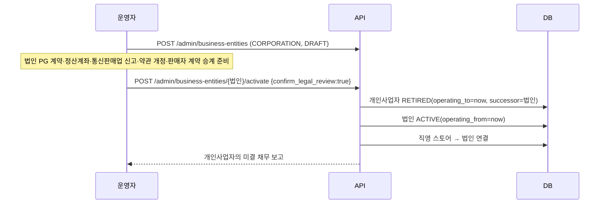

# E. 개인사업자 → 법인 확장 설계서

## 1. 원칙

1. 운영 주체는 하드코딩하지 않는다 → `business_entities` 테이블의 데이터.
2. **거래는 발생 시점의 운영 주체에 귀속**되고, 이후 바꿀 수 없다 → 주문·정산·분개에 `operator_entity_id` 스냅샷, DB 트리거로 변경 금지.
3. 전환은 '이 시점부터 새 거래는 새 주체'로 하는 **전진 적용**이며, 과거 거래를 옮기지 않는다. 남은 채무는 **보고**하고 별도 절차로 처리한다.

## 2. 현재(PHASE 1) 운영 구조

| 항목 | 구현 |
|---|---|
| 운영 사업자 정보 | `business_entities` (유형 INDIVIDUAL/CORPORATION, 상호, 대표, 사업자번호(검증번호 확인), 법인번호, 통신판매업 신고번호, 과세유형, 주소, 고객센터, 개인정보보호책임자, 호스팅, PG·에스크로·정산계좌 **참조값**, 약관 버전, 운영기간) |
| 활성 운영자 | 동시에 1개만 (`role='PLATFORM_OPERATOR' AND status='ACTIVE'` 부분 유니크 인덱스) |
| 미등록 시 | 체크아웃 503 `OPERATOR_NOT_CONFIGURED`, 푸터 경고 표시 |
| 사업자 정보 표시 | `GET /api/v1/business-info` → 푸터 (전자상거래법 제10조 표시 항목) |
| 직영(MODEL A) 스토어 | `partners.sales_model='DIRECT'`, `operator_entity_id`로 운영 주체에 연결 |
| 변경 이력 | `business_entity_events` (불변) + `admin_audit_log` |

PG 비밀키·계좌번호 원문은 DB에 두지 않습니다. 비밀키는 Worker Secret, DB에는 가맹점 계약 식별자 같은 참조값만 저장합니다.

## 3. PHASE 2~3 — 법인 설립 후 전환 절차

전환 시점에 API가 돌려주는 **이전 사업자 미결 항목** (`GET /admin/business-entities/{id}/obligations`):

| 항목 | 처리 방향 (법률·세무 확인 필요) |
|---|---|
| 결제대기 주문 | 이전 사업자 명의로 결제되므로, 전환 직전 신규 주문을 잠시 막거나 만료(30분)를 기다림 |
| 진행 중 배송 | 이전 사업자 거래로 완료 |
| 환불 가능 잔액 | 이전 사업자 PG 계약으로 환불해야 함 → 개인사업자 PG 계약을 환불 기간 동안 유지 |
| 판매자 미지급 정산 | 이전 사업자 명의로 지급 완료하거나, 판매자 동의하에 승계 |
| 미결 발주·클레임 | 이전 사업자 거래로 종결 |
| 사업자별 계정 잔액 | 시산표(`/admin/finance/trial-balance?entity_id=`)로 이관 회계 처리 근거 |

테스트 I29가 이 흐름을 검증합니다: 전환 전 주문은 개인사업자에 남고, 전환 후 주문·분개는 법인에 귀속되며, 과거 주문을 법인으로 바꾸려는 UPDATE는 DB가 거부합니다.

## 4. PHASE 4 — 그룹·계열사 (설계만, 미구현)

- `role='AFFILIATE'` 값은 스키마에 있으나 계열사별 매출 분리 라우팅은 구현하지 않았습니다(현재 불필요).
- 필요 시: 판매 채널/카테고리별 `operator_entity_id` 결정 규칙, 사업자 간 내부거래 분개, 사업자별 PG 라우팅이 추가 대상입니다.

## 5. 법률·세무·계약 검토 항목 (개발자가 확정할 수 없음)

| 항목 | 검토 주체 |
|---|---|
| 개인사업자 → 법인 **포괄 양수도** 여부, 사업양도 신고, 부가세 처리 | 세무사 |
| 통신판매업 신고 변경(신규 신고), 사업자 정보 표시 시점 | 법무/행정 |
| 회원 개인정보 이전 고지(개인정보 보호법 제27조 영업양도 등 이전 통지) | 법무 |
| 판매자 입점 계약·공급사 계약의 승계 동의 | 법무 |
| PG·에스크로(구매안전서비스) 계약 신규 체결, 기존 계약 환불 기간 유지 | PG사·법무 |
| 미정산금·환불 채무의 귀속과 이관 회계 | 세무사 |
| 이용약관·개인정보처리방침 개정과 고지 기간 | 법무 |
